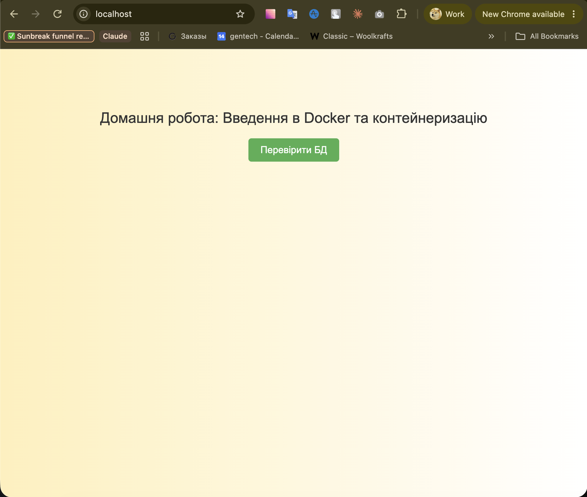
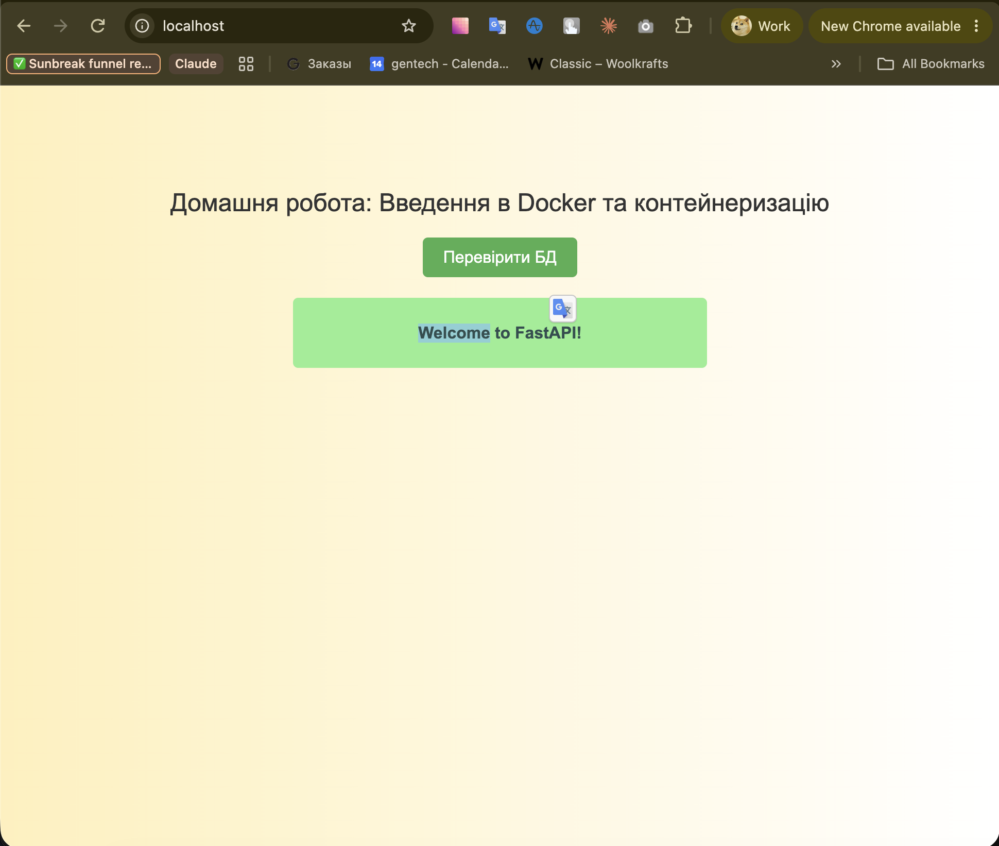

# goit-cs-hw-02

## Завдання 1

Скрипт перевіряє доступність сайтів через `curl` і записує результат у `website_status.log`.

```bash
cd task1
./check_websites.sh
```

## Завдання 2

FastAPI + PostgreSQL у Docker Compose.

```bash
cd task2
docker compose up --build
```

Відкрити http://localhost:8000 і натиснути «Перевірити БД».



